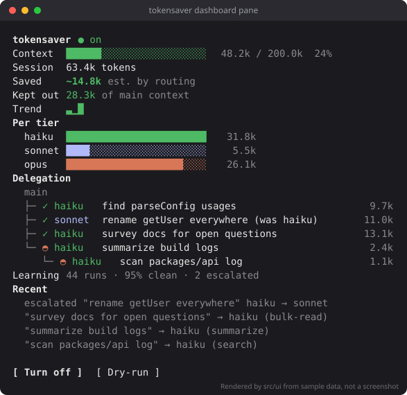

# tokensaver

[](https://github.com/AGregDev/claude-tokensaver/actions/workflows/ci.yml)
[](LICENSE)

A [Claude Code mod](https://code.claude.com/docs/en/plugins/mods/overview) with one job: spend fewer tokens without lowering the quality of the result.

It scores each task with cheap, deterministic heuristics, sends sub-agents to the cheapest model tier that can do the work, retries one tier up when a result fails its checks, and learns from the outcomes. It works in the Claude Code CLI and in the Code tab of the desktop app.






<sub>These pictures are generated by `npm run preview`: the mod's real renderers, run over a sample session. The first is the animated strip exactly as the desktop app receives it; the other two are the dashboard and status line text painted as SVG. They are not screenshots of a live session.</sub>

## Install

In a Claude Code session:

```text
/plugin install tokensaver --marketplace AGregDev/claude-tokensaver
```

Or from your shell:

```bash
claude plugin install tokensaver --marketplace AGregDev/claude-tokensaver
```

Answer `y` to add the marketplace and pick a scope. The mod is active at once. Mods need Claude Code v2.1.287 or later; the shell form of the command needs v2.1.292.

A mod is code that runs with your permissions. Before you install any mod, you can list what it hooks and calls without running it: clone the repository and run `claude plugin validate .` in it. [What it can reach](#what-it-can-reach) has tokensaver's list.

## What it does

### Routes sub-agents by tier

When Claude starts a sub-agent, tokensaver scores the sub-agent's task and picks its model:

| Tier | Used for |
| :- | :- |
| Haiku | Simple, mechanical work: searches, bulk reads, repetitive edits |
| Sonnet | Medium work, and anything Haiku-sized that the heuristics are unsure about |
| Opus | Hard reasoning, architecture, and every risky task |

The score comes from five signals read off the task text with regular expressions and counts: **scope** (how broad), **files** touched, **ambiguity**, **reasoning depth**, and **risk**. No model is called to classify anything, so scoring costs no tokens.

Every adjustment after the first pick moves up, never down:

- A score exactly on a cutoff goes to the higher tier.
- An unsure score (vague wording, an unrecognised kind of task) goes up one tier.
- A task that looks security-sensitive, destructive or production-touching always gets the top tier, and is never run below the model it would have had without tokensaver.
- A model Claude named itself is respected; tokensaver only ever raises it, and only for risky work.

An agent type can name its own model in its definition, and a spawn does not say whether it does. So tokensaver leaves the first spawn of each agent type in a session untouched and watches which model Claude Code resolves for it:

- If it resolves to the parent's model, the type inherits, and tokensaver routes that type from then on.
- If it resolves to anything else, the type brings its own model, as a custom agent with `model:` in its definition does, and tokensaver never reroutes it.

Forks, teammates and workflow agents are left alone, and so is any session whose model family tokensaver does not recognise.

The main conversation's own model is not switched. Changing models mid-session invalidates the prompt cache, which costs more than routing would save.

### Knows when delegating pays, and says so

You do not have to ask for sub-agents. For each prompt you type, tokensaver works out whether handing the reading to a sub-agent would cost less than Claude doing it inline, and when it would, it tells Claude to delegate.

The comparison uses measured numbers, not guesses:

- **Starting a sub-agent is expensive.** Its own system prompt and tools cost 30k to 38k tokens before it reads anything, measured in live sessions.
- **Reading inline is expensive later.** What the main loop reads stays in its context and is re-read on every following request.
- **A cheaper model does the reading.** The sub-agent runs on the tier tokensaver routes it to, and the main context keeps only its report.

How much reading a task means is estimated from the files the prompt names and, for a broad task, from the size of the repository, which tokensaver samples once per session (file names only, never contents). So "find every usage across the repo" earns a suggestion in a 600-file repository and none in a 40-file one, where a single search is cheaper than any sub-agent.

When delegating wins by a clear margin, tokensaver adds one line to the prompt: about how many files, and to use one Explore sub-agent or up to three in parallel. Claude makes the final call, because it can see the code and tokensaver cannot. That line is the only thing tokensaver ever adds to the model's context for a prompt, and its cost is subtracted from the savings counter.

tokensaver never starts a sub-agent itself. A sub-agent that a mod starts has not been through the safety review Claude's own actions get, and Claude Code refuses it in auto mode. Delegation stays Claude's own action.

### Escalates on failure

When a sub-agent's result fails its checks on a tier tokensaver picked, the same call is retried once on the next tier up, and Claude only sees the retry's result. The checks are:

- the call errored
- the answer is empty
- the answer reports failing tests
- the answer says it is unsure or did not finish

If your next prompt opens by rejecting the result ("no, that's wrong", "try again"), every sub-agent that turn is routed one tier up.

A denied call is never retried, and neither is a turn you interrupted.

## What you see

tokensaver changes how a session looks while work is being delegated:

- **A strip above the prompt** shows who is working for whom: the main loop, a line flowing out to each running sub-agent, and each sub-agent as a pill in its tier's colour. In the desktop app it is an animated vector; in the terminal it is a line of text with a spinner. It appears while a sub-agent runs and for a few seconds after an event (routed, escalated, finished), and is gone the rest of the time.
- **The spinner** says how many sub-agents are running and on which tier.
- **A sub-agent's row in the transcript** is marked with the tier tokensaver chose for it, and with where it came from if it was escalated.
- **A toast** appears when a sub-agent is rerouted or escalated.
- **A status line** under the prompt carries the session's tokens, the estimated savings, per-tier spend and a savings sparkline.
- **A dashboard pane** has the context meter, per-tier spend, the delegation tree and the savings trend. It opens by itself in the desktop app; in the terminal, `/tokensaver dashboard` opens it. Close it and it stays closed until you ask for it again.

Animation runs only while something is happening, and the timer stops when things settle.

- `NO_COLOR` (set to anything non-empty) removes every colour; state is still shown by glyphs and words.
- The `reducedMotion` option, or `/tokensaver motion off`, stops all movement and shows final figures at once.

None of the drawing reaches the model. A `/tokensaver` command does print one short line into the transcript, which Claude can read on later turns; that is what makes a command visible on every surface.

### What the two savings figures mean

Both are estimates, and they are kept apart on purpose because adding them would count the same tokens twice.

- **Saved (by routing)**: tokens a sub-agent used on a cheaper tier, weighted by relative cost (Haiku 1, Sonnet 3, Opus 5) against the model it would otherwise have run on. A failed attempt before a retry and tokensaver's own hint are subtracted, so the figure can go negative.
- **Kept out of main context**: for delegations tokensaver suggested, the tokens the sub-agent read and wrote, less the summary it handed back.

The cost weights are ratios for estimating, not prices. The token meter counts new work (input, output and cache writes) and leaves out cache reads.

## Commands

| Command | What it does |
| :- | :- |
| `/tokensaver` | Show status |
| `/tokensaver on` / `off` | Master switch. Off, every event passes through untouched |
| `/tokensaver dry-run [on\|off]` | Only show what would have been delegated or rerouted |
| `/tokensaver dashboard` | Open the dashboard pane |
| `/tokensaver motion [on\|off]` | Animations |
| `/tokensaver doctor` | What tokensaver knows (model, repository size, agent types) and what the display reported. Run this first if nothing shows |
| `/tokensaver export [path]` | Write the outcome log as JSON to a local file (default `tokensaver-export.json`) |
| `/tokensaver reset` | Clear the outcome log and the learned thresholds |
| `/tokensaver help` | List the commands |

Switches set with a command are remembered across sessions.

The most used ones are also listed in the `/` menu as `/tokensaver:status`, `/tokensaver:dashboard`, `/tokensaver:doctor`, `/tokensaver:on`, `/tokensaver:off`, `/tokensaver:dry-run` and `/tokensaver:help`. They do the same thing. They exist because `/tokensaver` itself is registered when a session starts running, so a brand-new session does not offer it in the menu until you have sent something; you can still type it in full.

## Options

Set these when you install, or later with `/plugin configure tokensaver@claude-tokensaver`.

| Option | Default | What it does |
| :- | :- | :- |
| `enabled` | `true` | Master switch |
| `dryRun` | `false` | Change nothing; show what would have happened |
| `contextHint` | `true` | Add the one-line delegation hint to prompts where delegating pays |
| `statusLine` | `true` | Show the status line under the prompt |
| `reducedMotion` | `false` | Turn off the spinner and the counting animation |

## How self-training works

Each finished delegation that tokensaver routed is appended to a local outcome log: the kind of task, the tier used, tokens, retries, whether it was escalated, and whether it passed its checks. The log holds counts and labels only. No prompt, file name or answer text is stored.

Routing is driven by two cutoffs per kind of task, and the log tunes them:

- **Tightening is immediate.** One failure, escalation or rejection lowers the cutoff that let the task onto that tier by 10 points, so fewer tasks of that kind reach it next time.
- **Loosening is slow and conditional.** A cutoff rises by 2 points only after at least 12 outcomes for that kind of task since its last change, every one of them a clean first-try success. A single failure in that window blocks it. Evidence is used once, and a cutoff can never drift more than 15 points above its default.
- **Risk is not tunable.** No amount of clean history lets a risky task run below the top tier.

The log and the thresholds live in the mod's own store on your machine (Claude Code keeps it under your Claude Code configuration directory). The log is capped at 500 entries. A corrupted log is read entry by entry; whatever does not parse is dropped and the rest is kept.

The bar a delegation suggestion must clear is learned the same lopsided way. When a turn ends, the suggestion made in it is judged by what happened: if Claude declined and then read only a few files, or the sub-agent barely did more than start, the suggestion was not worth making and the bar rises by a quarter at once. If the sub-agent did real work, the bar drops by a few percent.

**Nothing is sent anywhere.** The mod makes no network call at all. `/tokensaver export` writes a file on your disk, and `/tokensaver reset` deletes the log and the thresholds.

## Safety guarantees

Each guarantee below is enforced by a test, and the tests are part of CI.

| Guarantee | How it is held |
| :- | :- |
| Risky, destructive or production-touching work is never downgraded | A property test over every risky prompt, parent model and named model, under default thresholds and under the loosest thresholds learning could ever produce |
| Escalation only moves up | A property test over every tier, check result, retry count and flag: the retry is exactly one tier higher or does not happen |
| An agent type's own model is never overridden | A property test over every task and parent model, for a type known to bring its own model and for one not yet seen; a test inside Claude Code confirms it against the real `agent.spawn` event |
| Permission decisions are never overridden | The mod has no `tool.check` hook, so it cannot approve anything; a test inside Claude Code confirms `deny`, `ask` and `allow` come back unchanged, and that a denied call is returned untouched and not retried |
| It stacks with other mods | Every hook passes the event on with `next`, and every hook that could gate an event has a `.catch` that passes it on unchanged if the hook fails |
| It degrades instead of breaking | A failed store, environment or display call never fails the hook that made it, and a test runs the mod with none of them available. When no per-request usage arrives, the meter falls back to turn totals |

One thing it cannot soften: Claude Code checks a mod's event names when it loads the mod. On a build that lacks one of the events above, Claude Code refuses to load tokensaver and says which event, and your session carries on without it. tokensaver is typed and tested against Claude Code v2.1.292.

tokensaver runs after Claude Code's built-in `sec-default` guard and after any mod your organization lists ahead of user mods. It does nothing to work around either.

### What it can reach

This is the complete list, as `claude plugin validate` reads it from the source. The build fails if the list changes, so it cannot grow without a reviewed edit to `scripts/build.mjs`.

| It hooks | To |
| :- | :- |
| `session.start` | Load the log and settings, register `/tokensaver`, sample the repository's size |
| `session.attach` | Redraw when an app connects to the session |
| `prompt.submit` | Score the prompt; add the delegation line when it pays |
| `agent.spawn` | Choose the sub-agent's model |
| `tool.call` on `Agent` only | Read the result; retry once one tier up when it fails |
| `turn.step`, `turn.complete`, `session.measure` | Read token usage for the meter, and count how much the main loop reads itself |
| `command.run` for `tokensaver` | Answer its own command |
| `ui.render` for its own pane, the strip above the prompt, the spinner, and tool rows | Draw the dashboard and the strip; add to the spinner; mark sub-agent rows. Every other tool row is passed on untouched |
| `ui.close` for its own pane | Remember that you closed it |

| It calls | For |
| :- | :- |
| `$.store.get`, `set`, `delete` | The local log, thresholds and switches |
| `$.fs.write` | `/tokensaver export`, to the path you give |
| `$.fs.list` | Counting the repository's files once per session: names only, a few folders deep, capped |
| `$.env.get` | Reading `NO_COLOR`, and nothing else |
| `$.ui.status`, `toast`, `log`, `open`, `resolve` | Display |
| `$.state.get`, `set` | Redrawing the pane |
| `$.clock.every` | The animation timer |
| `$.command.register`, `$.session.surfaces`, `$.session.model` | Its command; telling the CLI from the desktop app; knowing which model the session runs on |

It does not call a model, start a sub-agent or a process, make a network request, read the contents of your files, or change a permission.

## Limits worth knowing

- The heuristics read text. They can misjudge a task, which is why every unsure case goes up a tier and why risk keywords are deliberately broad. A prompt that mentions "delete" or "production" in passing is treated as risky and gets no cheaper model.
- The first sub-agent of each agent type in a session is never rerouted, because that spawn is how tokensaver learns whether the type inherits its model. A session with a single sub-agent saves nothing by routing.
- The delegation estimate is built from the prompt's wording and the repository's size, not from the code. Claude can still decline a suggestion, and when it does the cost of the line (about 80 tokens) shows as a small negative saving and the bar for the next suggestion rises.
- Delegation only happens when Claude acts on the suggestion. tokensaver cannot make it happen, by design.
- "Failing tests" and "unsure" are detected from the sub-agent's answer text, so a failure the sub-agent does not report is not caught.
- A background sub-agent's result cannot be retried, because Claude has already moved on. Its outcome is still logged and still tightens the thresholds.
- The savings figures are estimates built on the weights above, not a bill.

## Development

```bash
git clone https://github.com/AGregDev/claude-tokensaver
cd claude-tokensaver
npm install
npm run types:sync
npm run check
```

`npm run check` runs the typecheck, lint, the unit, safety, integration and UI tests with an 80% coverage threshold, Claude Code's validator, the tests that run inside Claude Code, and the build. [CONTRIBUTING.md](CONTRIBUTING.md) has the layout and the details.

To try a working copy in a session:

```bash
claude --plugin-dir .
```

## License

[MIT](LICENSE)
