# tokensaver

[](https://github.com/AGregDev/claude-tokensaver/actions/workflows/ci.yml)
[](LICENSE)

A [Claude Code mod](https://code.claude.com/docs/en/plugins/mods/overview) that puts **Clawd**, Claude Code's pixel mascot, to work as your token-saving assistant.

Most token waste in a long session isn't the work itself. It's noise that piles up in the context and is re-sent with every request: install logs, progress bars, colour codes, a test runner printing the same warning 400 times. On top of that, a big context gets re-cached at full price after the prompt cache expires. Clawd goes after both:

- **Eats noise before it is stored.** Shell output is trimmed before it enters the conversation, so the model reads it once in its tidy form, and every later request carries the smaller version.
- **Tidies logs you paste.** The same cleanup for logs in your prompts. It is lossless, and your own writing is never touched.
- **Guards the context window.** Clawd speaks up as the context crosses 70% and 85%, and gives you a one-click **Compact now** that keeps your current task in focus. Auto-compact between turns is available if you opt in.
- **Wakes you up to a cold cache.** If you have been idle longer than the prompt cache lives, Clawd tells you that your next message re-writes the whole context to the cache, and how much less it would cost after compacting.
- **Routes helpers to cheaper models.** When Claude starts a sub-agent, tokensaver picks the cheapest model tier that can do the job, and retries one tier up if the result fails its checks.

Everything except routing works on its own, every turn: none of it depends on Claude choosing to delegate. It works in the Claude Code CLI and in the Code tab of the desktop app.







<sub>Drawn by `npm run preview` with the mod's real renderers over sample figures, exactly as the desktop app receives them. They animate on GitHub too. They are not screenshots of a live session.</sub>

### What the trimmer saves

Measured by `npm run bench` on the realistic outputs in [tests/fixtures/outputs.ts](tests/fixtures/outputs.ts). Every error line in every fixture survives the trim, and CI fails if one ever doesn't.

| Output | Tokens | After `full` | Saved | After `lossless` |
| :- | -: | -: | -: | -: |
| `npm install` with deprecation spam and progress frames | 4,337 | 221 | 95% | 3,977 |
| A jest run: 260 passes, 1 failure | 3,759 | 160 | 96% | 3,106 |
| `cargo build` with 340 crates and a type error | 2,809 | 102 | 96% | 2,809 |
| `docker build` progress | 2,228 | 983 | 56% | 2,228 |
| A 2,400-line server log with one error | 42,808 | 145 | ~100% | 42,808 |
| `git diff --stat` (clean output) | 353 | 353 | 0% | 353 |

Trimming a megabyte of mixed noise takes about 30 ms.

## Install

In a Claude Code session:

```text
/plugin install tokensaver --marketplace AGregDev/claude-tokensaver
```

Or from your shell:

```bash
claude plugin install tokensaver --marketplace AGregDev/claude-tokensaver
```

Answer `y` to add the marketplace and pick a scope. The mod is active at once. tokensaver needs Claude Code v2.1.299 or later.

In the desktop app, where `/plugin` does not run: click **+** next to the prompt box, then **Plugins**, **Add marketplace** with `AGregDev/claude-tokensaver`, then **Add plugin**.

To update to a new release:

```bash
claude plugin marketplace update claude-tokensaver
claude plugin update tokensaver@claude-tokensaver
```

Then start a new session (or run `/reload-plugins`). `/tokensaver doctor` says what loaded.

A mod is code that runs with your permissions. Before you install any mod, you can list what it hooks and calls without running it: clone the repository and run `claude plugin validate .` in it. [What it can reach](#what-it-can-reach) has tokensaver's list.

## What it does

### Trims tool output before it is stored

Every Bash and PowerShell result (and background shell output) passes through Clawd on its way into the conversation. That happens before the model reads it and before it is written to the transcript. The trims, in order:

| Trim | What it removes | Level |
| :- | :- | :- |
| Colour codes | ANSI escape sequences | lossless |
| Progress bars | frames a carriage return overwrote; only the last one was ever visible | lossless |
| Blank runs | trailing spaces, and runs of blank lines folded to one | lossless |
| Repeated lines | 3 or more identical lines in a row become one line plus a count | lossless |
| Look-alike lines | 6 or more lines that differ only in numbers or hashes keep the first two, a count and the last one. Error and warning lines are never folded | full |
| Huge outputs | past `maxOutputLines` (300 by default), the head and tail are kept, plus every error or warning line from the middle, with a note saying what was cut and how to see it | full |

File reads, searches, errors and anything a tool marks as failed are never touched. A trim that would save fewer than about 40 tokens is skipped. In the transcript, a trimmed row gets a line saying how much Clawd ate.

Why this matters more than it looks: the context is re-sent with every request. A 4k-token log trimmed to 400 tokens saves 3.6k on that request and 3.6k again on each request after it, until the next compaction. Clawd counts both numbers: **noise eaten**, and **re-sends avoided** (the trimmed tokens times the main-loop requests made since).

### Tidies pasted logs

When a prompt you type contains something that looks like a log (colour codes, or many lines with the same shape), Clawd applies only the lossless trims to it and shows a toast saying how much it saved. A slash command, a hidden prompt, or prose you wrote is left as typed.

### Guards the context window

Claude Code reports the context fill after each turn. As the fill crosses 70% and then 85%, Clawd says so once per level (in a toast, in the band above the prompt, and in the pane), with an estimate of how much a compaction would take off every request. **Compact now** (in the band, the pane, or `/tokensaver compact`) runs a normal compaction with focus instructions: keep the goal, the decisions, the changed files, open TODOs and your last few requests; drop raw tool output and dead ends.

Auto-compact is off by default. Set `autoCompactAt` (or run `/tokensaver autocompact 80`) and Clawd compacts by itself once the fill passes that mark, only between turns, never in the middle of one.

### Warns when the prompt cache goes cold

The prompt cache lives for a few minutes (5 by default; set `cacheTtlMinutes` to match your plan). After you have been idle that long with a context worth caching, Clawd falls asleep. The band, the status line and a toast then say that your next message re-writes the whole context to the cache, with the cost now and after a compaction. Compacting first is often the cheaper way back in.

### Routes sub-agents by tier

When Claude starts a sub-agent, tokensaver scores the sub-agent's task and picks its model:

| Tier | Used for |
| :- | :- |
| Haiku | Simple, mechanical work: searches, bulk reads, repetitive edits |
| Sonnet | Medium work, and anything Haiku-sized that the heuristics are unsure about |
| Opus | Hard reasoning, architecture, and every risky task |

The score comes from five signals read off the task text with regular expressions and counts: **scope** (how broad), **files** touched, **ambiguity**, **reasoning depth**, and **risk**. No model is called to classify anything, so scoring costs no tokens.

Every adjustment after the first pick moves up, never down:

- A score exactly on a cutoff goes to the higher tier.
- An unsure score (vague wording, an unrecognised kind of task) goes up one tier.
- A task that looks security-sensitive, destructive or production-touching always gets the top tier, and is never run below the model it would have had without tokensaver.
- A model Claude named itself is respected; tokensaver only ever raises it, and only for risky work.

An agent type can name its own model in its definition, and a spawn does not say whether it does. So tokensaver leaves the first spawn of each agent type in a session untouched and watches which model Claude Code resolves for it:

- If it resolves to the parent's model, the type inherits, and tokensaver routes that type from then on.
- If it resolves to anything else, the type brings its own model, as a custom agent with `model:` in its definition does, and tokensaver never reroutes it.

Forks, teammates and workflow agents are left alone, and so is any session whose model family tokensaver does not recognise.

The main conversation's own model is not switched. Changing models mid-session invalidates the prompt cache, which costs more than routing would save.

### Knows when delegating pays, and says so

You do not have to ask for sub-agents. For each prompt you type, tokensaver works out whether handing the reading to a sub-agent would cost less than Claude doing it inline, and when it would, it tells Claude to delegate.

The comparison uses measured numbers, not guesses:

- **Starting a sub-agent is expensive.** Its own system prompt and tools cost 30k to 38k tokens before it reads anything, measured in live sessions.
- **Reading inline is expensive later.** What the main loop reads stays in its context and is re-read on every following request.
- **A cheaper model does the reading.** The sub-agent runs on the tier tokensaver routes it to, and the main context keeps only its report.

How much reading a task means is estimated from the files the prompt names and, for a broad task, from the size of the repository, which tokensaver samples once per session (file names only, never contents). So "find every usage across the repo" earns a suggestion in a 600-file repository and none in a 40-file one, where a single search is cheaper than any sub-agent.

When delegating wins by a clear margin, tokensaver adds one line to the prompt: about how many files, and to use one Explore sub-agent or up to three in parallel. Claude makes the final call, because it can see the code and tokensaver cannot. That line is the only thing tokensaver ever adds to the model's context for a prompt, and its cost is subtracted from the savings counter.

tokensaver never starts a sub-agent itself. A sub-agent that a mod starts has not been through the safety review Claude's own actions get, and Claude Code refuses it in auto mode. Delegation stays Claude's own action.

### Escalates on failure

When a sub-agent's result fails its checks on a tier tokensaver picked, the same call is retried once on the next tier up, and Claude only sees the retry's result. The checks are:

- the call errored
- the answer is empty
- the answer reports failing tests
- the answer says it is unsure or did not finish

If your next prompt opens by rejecting the result ("no, that's wrong", "try again"), every sub-agent that turn is routed one tier up.

A denied call is never retried, and neither is a turn you interrupted.

## What you see

Clawd lives in three places, and its mood follows the session:

| Mood | When | What Clawd does |
| :- | :- | :- |
| idle | nothing to report | bobs and blinks |
| chomp | it just trimmed output or a paste | chews, with tokens flying into its mouth |
| happy | a compaction or a routing win | jumps, with sparkles |
| busy | a turn or a helper is running | walks, eyes darting |
| worried | context past 70% | trembles, with a sweat drop |
| sleepy | the prompt cache went cold | eyes shut, Zzz |
| alert | a helper failed and was escalated | shakes, with a red `!` |

- **The pane** (desktop app: opens by itself; terminal: `/tokensaver dashboard`): animated Clawd with a speech bubble, a context meter whose hatched segment shows what the context would hold without the trims, four savings tiles, buttons (Compact now, Trimming on/off, Paste tidy on/off, power), and an activity feed. In the terminal, Clawd is drawn in block glyphs.
- **The band above the prompt** appears for a few seconds after Clawd does something, and stays up with a **Compact now** button while the context is heavy or the cache is cold. While helpers run, the sub-agent strip shows beneath it.

  

- **The status line**: tokens used, noise eaten, re-sends avoided, context fill.
- **Transcript rows**: a trimmed shell row says how much was eaten; a routed sub-agent's row shows its tier.

Animation is CSS inside the picture, so it costs nothing while idle. `reducedMotion` (or `/tokensaver motion off`) stills everything, and `NO_COLOR` removes every colour from the text views.

### What the figures mean

All of them are estimates (about 4 characters to a token). They are kept apart because adding them up would count the same tokens twice.

- **Noise eaten**: tokens cut from tool output and pastes.
- **Re-sends avoided**: noise eaten, times the main-loop requests made since it was cut, until the next compaction. Re-sent context is usually read from the cache at a fraction of the price, so read this figure as context relief, not as money.
- **Freed by compacting**: the size before minus the size after, for each compaction Clawd saw.
- **Routing & delegation**: tokens a sub-agent used on a cheaper tier, weighted by relative cost (Haiku 1, Sonnet 3, Opus 5), plus the work delegated sub-agents kept out of the main context.

## Commands

| Command | What it does |
| :- | :- |
| `/tokensaver` | Status: what Clawd ate, re-sends avoided, context, routing |
| `/tokensaver compact` | Compact now, with focus instructions from your recent asks |
| `/tokensaver trim [on\|off]` | Trim noisy shell output before it is stored |
| `/tokensaver pastes [on\|off]` | Tidy pasted logs in your prompts |
| `/tokensaver autocompact <0-95>` | Compact between turns past this fill %; 0 means never |
| `/tokensaver on` / `off` | Master switch. Off, every event passes through untouched |
| `/tokensaver dry-run [on\|off]` | Only show what would have been trimmed or rerouted |
| `/tokensaver dashboard` | Open Clawd's pane |
| `/tokensaver motion [on\|off]` | Animations |
| `/tokensaver doctor` | What tokensaver knows and what the display reported. Run this first if nothing shows |
| `/tokensaver export [path]` | Write the routing outcome log as JSON to a local file |
| `/tokensaver reset` | Clear the routing log and the learned thresholds |
| `/tokensaver help` | List the commands |

Switches set with a command are remembered across sessions. `/tokensaver:status`, `:compact`, `:trim`, `:dashboard`, `:doctor`, `:on`, `:off`, `:dry-run` and `:help` are listed in the `/` menu from the very first prompt.

## Options

Set these when you install, or later with `/plugin configure tokensaver@claude-tokensaver`.

| Option | Default | What it does |
| :- | :- | :- |
| `enabled` | `true` | Master switch |
| `trimOutput` | `true` | Trim noisy shell output before it is stored |
| `trimLevel` | `full` | `lossless` only removes what carries no information; `full` also folds look-alike lines and caps huge outputs |
| `maxOutputLines` | `300` | Under `full`, longer outputs keep their head, tail and error lines |
| `trimPastes` | `true` | Tidy logs pasted into prompts (lossless) |
| `autoCompactAt` | `0` | Compact between turns past this fill %; 0 means suggest only |
| `cacheTtlMinutes` | `5` | Prompt cache lifetime, for the cold-cache warning; 0 turns it off |
| `dryRun` | `false` | Change nothing; show what would have happened |
| `contextHint` | `true` | Add the one-line delegation hint to prompts where delegating pays |
| `statusLine` | `true` | Show the status line under the prompt |
| `reducedMotion` | `false` | Turn off all animation |

## How self-training works

Each finished delegation that tokensaver routed is appended to a local outcome log: the kind of task, the tier used, tokens, retries, whether it was escalated, and whether it passed its checks. The log holds counts and labels only. No prompt, file name or answer text is stored.

Routing is driven by two cutoffs per kind of task, and the log tunes them:

- **Tightening is immediate.** One failure, escalation or rejection lowers the cutoff that let the task onto that tier by 10 points, so fewer tasks of that kind reach it next time.
- **Loosening is slow and conditional.** A cutoff rises by 2 points only after at least 12 outcomes for that kind of task since its last change, every one of them a clean first-try success. A single failure in that window blocks it. Evidence is used once, and a cutoff can never drift more than 15 points above its default.
- **Risk is not tunable.** No amount of clean history lets a risky task run below the top tier.

The log and the thresholds live in the mod's own store on your machine (Claude Code keeps it under your Claude Code configuration directory). The log is capped at 500 entries. A corrupted log is read entry by entry; whatever does not parse is dropped and the rest is kept.

The bar a delegation suggestion must clear is learned the same lopsided way. When a turn ends, the suggestion made in it is judged by what happened: if Claude declined and then read only a few files, or the sub-agent barely did more than start, the suggestion was not worth making and the bar rises by a quarter at once. If the sub-agent did real work, the bar drops by a few percent.

**Nothing is sent anywhere.** The mod makes no network call at all. `/tokensaver export` writes a file on your disk, and `/tokensaver reset` deletes the log and the thresholds.

## Safety guarantees

Each guarantee below is enforced by a test, and the tests are part of CI.

| Guarantee | How it is held |
| :- | :- |
| Risky, destructive or production-touching work is never downgraded | A property test over every risky prompt, parent model and named model, under default thresholds and under the loosest thresholds learning could ever produce |
| Escalation only moves up | A property test over every tier, check result, retry count and flag: the retry is exactly one tier higher or does not happen |
| An agent type's own model is never overridden | A property test over every task and parent model, for a type known to bring its own model and for one not yet seen; a test inside Claude Code confirms it against the real `agent.spawn` event |
| Permission decisions are never overridden | The mod has no `tool.check` hook, so it cannot approve anything; a test inside Claude Code confirms `deny`, `ask` and `allow` come back unchanged, and that a denied call is returned untouched and not retried |
| It stacks with other mods | Every hook passes the event on with `next`, and every hook that could gate an event has a `.catch` that passes it on unchanged if the hook fails |
| It degrades instead of breaking | A failed store, environment or display call never fails the hook that made it, and a test runs the mod with none of them available. When no per-request usage arrives, the meter falls back to turn totals |

One thing it cannot soften: Claude Code checks a mod's event names when it loads the mod. On a build that lacks one of the events above, Claude Code refuses to load tokensaver and says which event, and your session carries on without it. tokensaver is typed and tested against Claude Code v2.1.299 (the in-engine tests for the output trimmer need 2.1.299's test kit).

tokensaver runs after Claude Code's built-in `sec-default` guard and after any mod your organization lists ahead of user mods. It does nothing to work around either.

### What it can reach

This is the complete list, as `claude plugin validate` reads it from the source. The build fails if the list changes, so it cannot grow without a reviewed edit to `scripts/build.mjs`.

| It hooks | To |
| :- | :- |
| `session.start` | Load the log and settings, register `/tokensaver`, sample the repository's size |
| `session.append` on Claude's responses | Note which command each shell call ran (read only), so a search's output is never folded |
| `session.append` on tool results only | Trim shell output before it is stored |
| `session.compact` | Book what a compaction freed, and calm Clawd down |
| `session.attach` | Redraw when an app connects to the session |
| `prompt.submit` | Tidy a pasted log; score the prompt; add the delegation line when it pays |
| `agent.spawn` | Choose the sub-agent's model |
| `tool.call` on `Agent` only | Read the result; retry once one tier up when it fails |
| `turn.step`, `turn.complete`, `session.measure` | Read token usage for the meter, and count how much the main loop reads itself |
| `command.run` for `tokensaver` | Answer its own command |
| `ui.render` for its own pane, the strip above the prompt, the spinner, and tool rows | Draw Clawd's pane and band; add to the spinner; mark trimmed shell rows and routed sub-agent rows. Every other row is passed on untouched |
| `ui.close` for its own pane | Remember that you closed it |

| It calls | For |
| :- | :- |
| `$.store.get`, `set`, `delete` | The local log, thresholds and switches |
| `$.fs.write` | `/tokensaver export`, to the path you give |
| `$.fs.list` | Counting the repository's files once per session: names only, a few folders deep, capped |
| `$.env.get` | Reading `NO_COLOR`, and nothing else |
| `$.ui.status`, `toast`, `log`, `open`, `resolve` | Display |
| `$.state.get`, `set` | Redrawing the pane |
| `$.clock.every`, `after` | The animation timer; the cold-cache check; starting a compaction once a command has returned |
| `$.session.compact` | Compacting, when you press Compact now or run `/tokensaver compact`, or past `autoCompactAt` if you set it |
| `$.command.register`, `$.session.surfaces`, `$.session.model` | Its command; telling the CLI from the desktop app; knowing which model the session runs on |

It does not call a model, start a sub-agent or a process, make a network request, read the contents of your files, or change a permission. The only text it changes is shell output and pasted logs on their way into the conversation, as described above.

## Limits worth knowing

- The trimmer reads shapes, not meaning. Under `full`, a huge output keeps its head, tail and error lines, and a long run of look-alike lines is folded; if Claude needs a line that was cut, the note in the output tells it to re-run with a filter. Set `trimLevel` to `lossless` if you never want lines dropped.
- Token counts are estimated at about 4 characters a token.
- The cold-cache warning goes by the clock: it cannot see the cache itself, so set `cacheTtlMinutes` to your plan's cache lifetime.
- The heuristics read text. They can misjudge a task, which is why every unsure case goes up a tier and why risk keywords are deliberately broad. A prompt that mentions "delete" or "production" in passing is treated as risky and gets no cheaper model.
- The first sub-agent of each agent type in a session is never rerouted, because that spawn is how tokensaver learns whether the type inherits its model. A session with a single sub-agent saves nothing by routing.
- The delegation estimate is built from the prompt's wording and the repository's size, not from the code. Claude can still decline a suggestion, and when it does the cost of the line (about 80 tokens) shows as a small negative saving and the bar for the next suggestion rises.
- Delegation only happens when Claude acts on the suggestion. tokensaver cannot make it happen, by design.
- "Failing tests" and "unsure" are detected from the sub-agent's answer text, so a failure the sub-agent does not report is not caught.
- A background sub-agent's result cannot be retried, because Claude has already moved on. Its outcome is still logged and still tightens the thresholds.
- The savings figures are estimates built on the weights above, not a bill.

## Development

```bash
git clone https://github.com/AGregDev/claude-tokensaver
cd claude-tokensaver
npm install
npm run types:sync
npm run check
```

`npm run check` runs the typecheck, lint, the unit, safety, integration, UI and efficiency tests with an 80% coverage floor, Claude Code's validator, the tests that run inside Claude Code, and the audited build. `npm run bench` prints the trimmer's savings table. [CONTRIBUTING.md](CONTRIBUTING.md) has the details.

To try a working copy in a session (disable an installed copy first, so only one loads):

```bash
claude --plugin-dir .
```

Working with Claude Code on this repository: [.claude/CLAUDE.md](.claude/CLAUDE.md) holds the layout, the rules and the engine quirks, and the `verify-tokensaver` skill in `.claude/skills/` walks an agent through checking a change end to end, live test included.

## License

[MIT](LICENSE)
